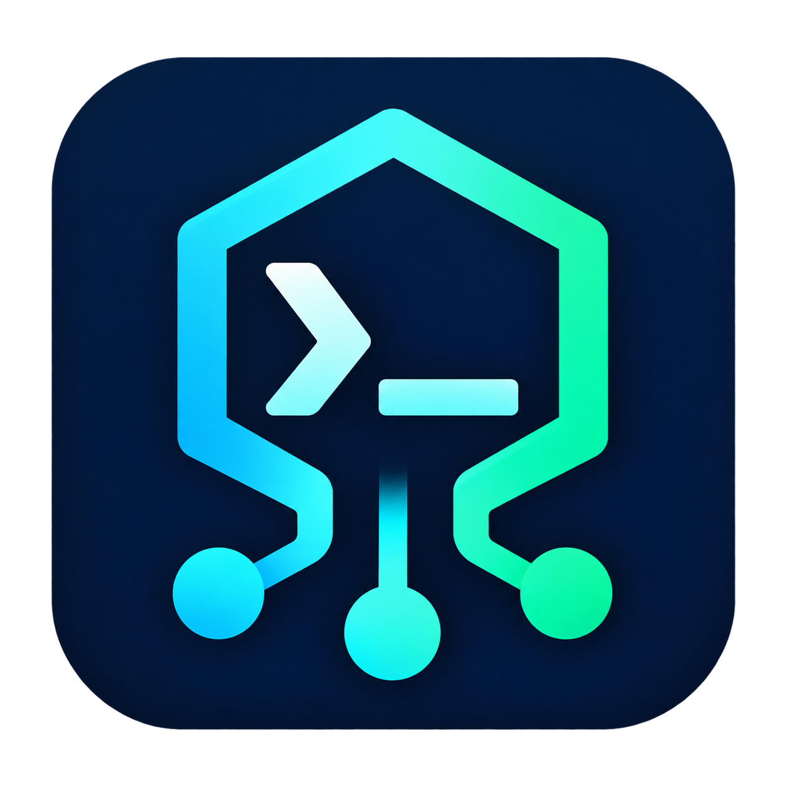

<p align="center">
  
</p>

<h1 align="center">Agent Harness Installer</h1>

<p align="center">
  <strong>One command. Six coding agents. Ready for your VPS.</strong><br>
  A self-contained Bash installer for headless machines, with vendor installers or mise.
</p>

<p align="center">
  <a href="https://github.com/dazeb/agent-harness-installer/actions/workflows/ci.yml"></a>
  <a href="https://github.com/dazeb/agent-harness-installer/commits/main"></a>
  <a href="LICENSE"></a>
</p>

## Install in one command

Run this over SSH as a **normal user** with Bash 4+ and curl:

```bash
bash -c "$(curl -fsSL https://raw.githubusercontent.com/dazeb/agent-harness-installer/main/install-agent-harnesses.sh)"
```

Choose **regular install** or **mise** in the text picker. The script detects working agents,
installs what is missing, verifies the commands, and prints authentication instructions and log paths.
Already installed agents stay as they are unless you choose to upgrade.

On a fresh VPS logged in as root, create a user first (Debian/Ubuntu example):

```bash
adduser dev
su - dev
```

**Want just Claude and Codex?** Add options after a trailing `bash`:

```bash
bash -c "$(curl -fsSL https://raw.githubusercontent.com/dazeb/agent-harness-installer/main/install-agent-harnesses.sh)" bash --no-input --only claude,codex --fix-path
```

The URL tracks `main`. To inspect the script before running it, use the
[download or clone instructions](#download-or-clone). Agent authentication is a separate step;
see [headless authentication](#authentication-headless).

<p align="center">
  <a href="#what-it-installs">Supported agents</a> ·
  <a href="#common-workflows">Common workflows</a> ·
  <a href="#requirements">Requirements</a> ·
  <a href="#usage">All options</a> ·
  <a href="#troubleshooting">Troubleshooting</a> ·
  <a href="#development">Development</a>
</p>

## Built for SSH and fresh machines

- **User-space installs.** No sudo or system package installation by this script. Agent files
  live in user directories; temporary downloads and logs use the system temporary directory.
- **Two install methods.** Use each vendor's installer, or let mise manage versions and upgrades.
- **Repeatable runs.** Working commands are skipped by default. Select agents with `--only` or `--skip`.
- **Verification after installation.** The script starts each command to check that it runs,
  then prints its version and executable location.
- **Recoverable configuration edits.** PATH and mise configuration changes are backed up before
  editing, with `--restore` to recover the previous files.
- **Headless operation.** Upstream installers get closed stdin and log output; on Linux,
  `setsid` also removes their controlling terminal. `--no-input` disables the installer's picker.

## Common workflows

The examples below use a local copy of the script. The same options work with the one-liner
by adding `bash` followed by the options, as shown above.

| Goal | Command |
|---|---|
| See what is installed without installing anything | `./install-agent-harnesses.sh --check` |
| Preview an unattended vendor install | `./install-agent-harnesses.sh --no-input --dry-run` |
| Install only Claude and Codex | `./install-agent-harnesses.sh --no-input --only claude,codex` |
| Install all except Gemini | `./install-agent-harnesses.sh --no-input --skip gemini` |
| Upgrade one agent | `./install-agent-harnesses.sh --no-input --only codex --upgrade` |
| Install through an existing mise setup | `./install-agent-harnesses.sh --backend mise` |
| Persist agent directories for future login shells | `./install-agent-harnesses.sh --no-input --fix-path` |
| Show configuration restore points | `./install-agent-harnesses.sh --restore-list` |
| Undo the latest recorded configuration changes | `./install-agent-harnesses.sh --restore` |

### Unattended installs

For cloud-init, Ansible, or cron, use a normal user's account and explicitly disable prompts:

```bash
curl -fsSL https://raw.githubusercontent.com/dazeb/agent-harness-installer/main/install-agent-harnesses.sh | bash -s -- --no-input --only claude,codex --fix-path
```

`bash -c "$(curl …)"` keeps terminal input available for the picker. The pipe form uses stdin to
read the script and does not open the picker automatically. Avoid `--interactive` with the pipe
form; use the first one-liner or a downloaded copy when you want to answer questions.

For automation that must distinguish a download failure from a successful run, download first
and execute only if curl succeeds:

```bash
curl -fsSL https://raw.githubusercontent.com/dazeb/agent-harness-installer/main/install-agent-harnesses.sh -o install-agent-harnesses.sh && bash install-agent-harnesses.sh --no-input
```

### Download or clone

No GitHub account or SSH key is needed:

```bash
git clone https://github.com/dazeb/agent-harness-installer.git
cd agent-harness-installer
./install-agent-harnesses.sh --check
./install-agent-harnesses.sh --no-input --dry-run
./install-agent-harnesses.sh
```

Or download the single script, inspect it, then run:

```bash
curl -fsSLO https://raw.githubusercontent.com/dazeb/agent-harness-installer/main/install-agent-harnesses.sh
less install-agent-harnesses.sh
bash install-agent-harnesses.sh
```

To use a reviewed revision, replace `main` in the download URL with a full commit SHA. This pins
**the installer script**; vendor installers still fetch their own releases. Use mise's version
management when you need to pin the agents themselves.

## What it installs

| Harness | Command | Vendor | Primary installer | Fallback | Binary lands in |
|---|---|---|---|---|---|
| Claude Code | `claude` | Anthropic | `claude.ai/install.sh` | `@anthropic-ai/claude-code` (npm) | `~/.local/bin/claude` |
| Codex CLI | `codex` | OpenAI | `chatgpt.com/codex/install.sh` | `@openai/codex` (npm) | `~/.local/bin/codex` |
| OpenCode | `opencode` | Anomaly | `opencode.ai/install --no-modify-path` | `opencode-ai` (npm) | `~/.opencode/bin` + symlink |
| Gemini CLI | `gemini` | Google | npm `@google/gemini-cli` | `brew install gemini-cli` | npm global prefix |
| Amp | `amp` | Sourcegraph | `ampcode.com/install.sh` | `@sourcegraph/amp` (npm) | `~/.amp/bin` + symlink |
| Pi | `pi` | Earendil Works | `pi.dev/install.sh` | `@earendil-works/pi-coding-agent` (npm) | `~/.pi/agent` + symlink |

With the vendor backend, native installers are preferred where available; their npm fallback is
used when the installer fails. Gemini starts with npm and can fall back to Homebrew. Already-installed detection uses `--version`. Post-install verification tries `--version`,
`-v`, then `--help`, with time limits on those probes. Installer success alone is not enough.

Passing `--backend mise` swaps the whole table for [mise](https://mise.jdx.dev/) specs instead (see
[Version management](#version-management-vendor-installers-or-mise)).

## Version management: vendor installers or mise

Default (`--backend vendor`): use each harness's installer with an npm fallback where provided.
Gemini uses npm first, then Homebrew. The wrapper does not schedule updates; rerun with
`--upgrade` to refresh working installs.

If the machine already runs [mise](https://mise.jdx.dev/), you can hand version ownership to it:

```bash
./install-agent-harnesses.sh --backend mise            # install/repair through mise
./install-agent-harnesses.sh --backend mise --check    # verify, touch nothing
./install-agent-harnesses.sh --backend mise --upgrade  # re-resolve @latest for each tool
```

Each tool is written to the global `~/.config/mise/config.toml` with `mise use -g <spec>@latest`,
and the result is verified through `mise which` — so nothing depends on `mise activate` being
loaded in the current shell, and a shim that prints warnings on stderr cannot poison the version
string. Short specs resolve through mise's registry, so the backend and package can change as the registry
evolves. Inspect `mise ls -g` after installation to confirm what it selected.

| Harness | mise spec | Backend | Notes |
|---|---|---|---|
| claude | `claude` | mise registry | registry selects the download backend |
| codex | `codex` | mise registry | registry selects the download backend |
| opencode | `opencode` | mise registry | check the resolved package and major version |
| gemini | `gemini` | `npm:@google/gemini-cli` | npm backend needs Node on `PATH` |
| amp | `npm:@ampcode/cli` | explicit npm spec | avoids relying on the `amp` registry short name |
| pi | `pi` | mise registry | registry selects the download backend |

Why you might prefer it:

- **Pin and roll back** — `mise use -g codex@0.160.0` is one line; the vendor installers only ever
  give you "latest". `mise upgrade` then updates everything together, `mise ls -g` is the inventory.
- **Verified artifacts** — mise can use aqua release verification where supported by the selected
  registry entry; the exact checks depend on that backend.
- **No sudo, no npm global prefix** — the same reason this script exists.

What it costs:

- mise becomes a dependency (`curl https://mise.run | sh`, or apt/brew): a bare box that has none
  fails fast with that hint rather than silently falling back.
- the npm backend shells out to Node, so Gemini needs a Node runtime in mise's resolution too.
- the registry can lag a vendor release, and `ls-remote` is blind for npm-only names like Amp.
- mise's `minimum_release_age` hides builds that are too new. Amp publishes every few hours, so on a
  default mise `--backend mise` can fail for Amp with `no versions found`. The installer says so and
  offers two ways out: `mise settings set minimum_release_age 0s` (you accept fresh builds), or
  `--backend vendor --only amp` (native installer for that one tool).
- OpenCode can differ by backend and registry revision. Check the resolved package and major
  version before switching an existing setup.

**Do not run both.** Two owners per command name is how a box ends up with `codex` 0.163.0 on
`PATH` while mise still pins 0.160.0 — exactly the drift `--check` surfaces. Before switching, inspect
`command -v <tool>` and `mise ls -g`, then remove the old installation using its owning package manager. `mise prune` alone does not switch the configured owner.

`--fix-path` writes the agent PATH block to `~/.profile`, an existing `~/.bash_profile`, and the
zsh login profile when zsh is detected (`${ZDOTDIR:-$HOME}/.zprofile`). With `--backend mise`,
it also adds a guarded `mise activate bash` / `mise activate zsh` block. Open a new login shell
afterward; the installer runs in a child shell and cannot change your current shell's PATH.

## Interactive walkthrough

```console
$ ./install-agent-harnesses.sh
agent harness installer — headless, user-space, no sudo
    host:    Linux x86_64 — Ubuntu 26.04.1 LTS
    user:    dazeb (uid 1000, shell /usr/bin/zsh)
    node:    22.20.0
    npm:     10.9.4
    log dir: /tmp/agent-harnesses-20261021-031500

==> Environment
    os:      Ubuntu 26.04.1 LTS
    arch:    x86_64, kernel 7.0.0-38-generic
    shell:   /usr/bin/zsh
    node:    22.20.0
    npm:     10.9.4
    mise:    2026.10.0

==> What is already installed
    claude    2.1.305 (Claude Code)           /home/dazeb/.local/bin/claude
    codex     codex-cli 0.163.0               /home/dazeb/.local/bin/codex
    opencode  not installed
    gemini    not installed
    amp       not installed
    pi        not installed

==> Which install method?
    [1] Regular install  (default)
        ...explanation...
    [2] mise
        ...explanation...
    Choose 1 (regular), 2 (mise) or q to quit: [1] 2
    [ok]   method: mise
    Upgrade the 2 installed harness(es) as well? [n] n
    backend: mise
```

Notes on the flow:

- Answers are plain text: `1`, `2`, `q`, `y`, `n`. Enter accepts the `[bracketed]` default, and `q`
  exits without writing anything. `Ctrl-D` behaves like the default.
- Choosing `2` when `mise` is missing offers to install it (`curl https://mise.run | sh`, user-space,
  one file: `~/.local/bin/mise`); declining falls back to `[1]` rather than failing later.
- If anything is already installed, one extra question asks whether to upgrade it — otherwise the
  run is idempotent and only fills the gaps.
- After the install: a summary table, the **Executable locations** section (with
  `claude runs from: /home/dazeb/.local/share/mise/installs/claude/2.1.305/bin/claude` and the exact
  smoke test), the headless-auth guide, and the method's upgrade command.
- `--interactive` forces the picker even when stdin is a pipe (that is how the CI gate tests it);
  `--no-input` never prompts.

Or without cloning:

```bash
curl -fsSL https://raw.githubusercontent.com/dazeb/agent-harness-installer/main/install-agent-harnesses.sh \
  | bash -s -- --check
```

Every run ends with a summary table, a headless-authentication checklist, the log directory, and a
non-zero exit code if anything failed.

## Usage

```
./install-agent-harnesses.sh [options]

  --check          report status only; never install   (exit 1 if something is missing)
  --dry-run        print what would be installed; change nothing
  --backend NAME   vendor (default, each vendor's own installer) or mise
  --interactive    force the method picker, even when stdin is not a TTY
  --no-input       never prompt; keep the vendor default (alias: --yes)
  --upgrade        re-run the upstream installer even if the tool already works
  --only TOOLS     restrict to a comma/space list: claude,codex,opencode,gemini,amp,pi
  --skip TOOLS     exclude a comma/space list
  --fix-path       persist PATH in applicable login profiles (with backups)
  --restore        put back the files edited by the last run
  --restore-list   show the recorded restore points
  --verbose        stream installer output instead of only logging it
  -h, --help       this help
```

Examples:

```bash
./install-agent-harnesses.sh --only amp,pi         # install just two
./install-agent-harnesses.sh --skip gemini         # everything except Gemini
./install-agent-harnesses.sh --only codex --upgrade
./install-agent-harnesses.sh --backend mise        # let mise own the versions
./install-agent-harnesses.sh -i --dry-run          # try the picker without installing
./install-agent-harnesses.sh --restore             # undo the last profile/mise edits
```

Idempotent: tools that already answer `--version` are skipped (or upgraded with `--upgrade`).

## Requirements

- **Linux is the main target.** Bash 4+ and standard command-line utilities are required,
  including `timeout`. On macOS, the stock Bash 3.2 is too old; provide modern Bash and a
  `timeout` command before running. The gate below targets Linux.
- **Downloads:** curl or wget for local-script runs; the one-liner specifically requires curl.
- **Node/npm:** the vendor path checks Node >= 20 for Gemini and Node >= 22.19 for Pi. npm
  fallbacks also need Node/npm; the required version can depend on the downloaded package.
  The script does not provision Node.
- **mise:** required for explicit `--backend mise` runs. The interactive picker can offer to
  install it; Gemini and Amp use npm-based mise specs and need Node/npm available.
- **Network:** HTTPS access to vendor installers, package registries, and release hosts.
- **Writable user directories:** installations, optional profile edits, and configuration backups
  need space in your home directory.
- Not root: the script refuses to run as `root` because every installer writes into `$HOME`.

## Exit codes

| Code | Meaning |
|---|---|
| `0` | requested operation succeeded; install/check verification passed, or a dry run/help/restore completed |
| `1` | at least one harness failed, or `--check` found a missing harness |
| `2` | usage error (unknown flag, unknown tool name, missing curl/wget, running as root) |

## How headless installs work

Upstream installers can change their behavior when they detect a terminal. The script reduces
interactive prompts with a consistent execution environment:

- each installer is **downloaded to a temp file first**, then executed as
  `setsid -w CMD </dev/null >>log 2>&1` when `setsid` is available — its own session, no
  controlling terminal, stdin at EOF. Without `setsid`, stdin is still closed and output logged;
- `CI=1`, `CODEX_NON_INTERACTIVE=1`, `npm_config_yes=true`, `npm_config_fund/audit=false` and
  `DEBIAN_FRONTEND=noninteractive` are exported for children;
- the installer's `--no-modify-path` / `--prefix` style flags are used where they exist, and PATH is
  rebuilt and re-exported after each install instead of relying on a login shell;
- **no automatic system package installation**: the script does not invoke sudo or apt. It
  checks Pi's Node prerequisite before running its upstream installer;
- dangling `~/.local/bin/<tool>` and `~/bin/<tool>` symlinks left by an older npm or git install are
  pruned before installing, because they make "installer succeeded" look truthful while
  `command -v` resolves to nothing.

Failure output is the last 25 lines of the log, with the full log kept under
`$TMPDIR/agent-harnesses-<timestamp>.<random>/` (under `/tmp` when `TMPDIR` is unset).
Upstream install processes have no overall timeout; the version and help probes do.

## Authentication (headless)

Installing is the easy half. These agents still need credentials, and none of them can open a
browser for you. The script's built-in **Headless authentication** section prints the exact
commands; the short version:

| Harness | Headless path | Notes |
|---|---|---|
| Claude Code | `claude setup-token` → `export CLAUDE_CODE_OAUTH_TOKEN=…` | long-lived token created from a browser session on another machine; `ANTHROPIC_API_KEY` also works |
| Codex CLI | `codex login --device-auth` | device-code flow: prints a URL + code, paste it into any browser; or use `OPENAI_API_KEY` |
| OpenCode | `opencode auth login` (paste an API key) | providers live in `~/.local/share/opencode/auth.json`; provider env vars also work |
| Gemini CLI | `GEMINI_API_KEY`, or the CLI's authentication settings | use the API-key route for a browserless server |
| Amp | `export AMP_API_KEY=…` | **no device-code flow.** The value must be an access token from `ampcode.com/settings/security`; `amp login` is a browser-callback flow and cannot complete headless. Check with `amp account list` (there is no `whoami`) |
| Pi | `pi` interactive login, or provider env vars | subscriptions (`~/.pi/agent/auth.json`) need a browser/device step; API keys via env are the headless route |

Keep secrets in a `600` file sourced from your profile (e.g. `~/.config/agent-env.sh`), not inline in
shell history. `--check` and the summary look for credential content or a matching environment variable; `{}`
counts as absent. This is a local heuristic, **not a request to the provider**: it cannot prove
that a token is valid, a subscription is active, or the selected model is available. Run a small
agent request after login to verify access (normal provider usage charges may apply).

## Troubleshooting

| Symptom | Cause / fix |
|---|---|
| Installer seems to hang | read the log in the printed log directory. Version/help probes have timeouts; upstream install processes have no overall timeout. Interrupt with Ctrl-C if needed; the script forwards termination to the active installer |
| `installer reported success but <bin> is not runnable` | usually a dangling shim: `command -v <bin>; ls -l "$(command -v <bin>)"`. Re-run the script — it prunes dangling links before installing |
| Wrong version or unexpected binary | compare `command -v <tool>` with `mise ls -g` and the executable locations printed by the installer. Remove the duplicate through its owning installer |
| Gemini or Pi fails its Node prerequisite | Gemini checks Node >= 20; Pi checks >= 22.19. Install a suitable Node runtime and npm, then rerun with `--only gemini` or `--only pi` |
| New shell does not see a tool | rerun with `--fix-path` and the same backend, then open a login shell. Check `command -v <tool>` and the printed executable locations |
| The brew fallback fires in a container | it is the last resort for Gemini only; if Homebrew exists but its registry is unreachable, `--skip gemini` and install via npm |

## Reversibility

Configuration edits are backed up first. Before the script appends a PATH block to `~/.profile` / `~/.zprofile`,
lets `mise use -g` rewrite `~/.config/mise/config.toml`, or deletes a dangling symlink, it records
what was there:

```console
==> Reversibility
    backups:   /home/dazeb/.local/state/agent-harnesses/backups/20261021-031500-412927
    manifest:  /home/dazeb/.local/state/agent-harnesses/manifest.tsv
    undo last: ./install-agent-harnesses.sh --restore
    see all:   ./install-agent-harnesses.sh --restore-list
```

- `~/.local/state/agent-harnesses/backups/<run>/…` holds a byte copy of every edited file, mirroring
  its `$HOME` path; `manifest.tsv` is the append-only ledger (`timestamp`, `run`, `file|symlink`,
  original, backup or link target).
- `--restore-list` prints the ten most recent runs and what each one touched.
- `--restore` restores the newest run; `--restore=<run>` a specific one. A restore snapshots the
  current file first, so **undoing a restore is itself undoable**. A file the run *created* (e.g. a
  `~/.profile` that was absent, or a fresh `~/.config/mise/config.toml`) is removed again — its
  current content is snapshotted first — and a pruned dangling symlink is recreated. Files are
  restored whole, so edits made after the run are replaced (they stay recoverable from the snapshot).
- Only files are reverted. Installed binaries are additive and left alone — see
  [Uninstall](#uninstall) for those, or `mise uninstall <tool>` when mise owned the version.
- If a file cannot be copied (read-only `$HOME`, full disk), the script skips the edit instead of
  proceeding unbacked.

## Uninstall

Use the package manager or installer that owns each command. Inspect its location first:

```bash
command -v claude codex opencode gemini amp pi
npm list -g --depth=0
mise ls -g
```

For npm installs, use `npm uninstall -g <package>` with the package from the
[supported-agent table](#what-it-installs). For mise installs, remove the tool from the global configuration
and use `mise uninstall <tool>` for the versions you no longer need.
For native installs, follow the owning tool's uninstall instructions and use the printed
executable location to identify its files.

Agent directories can contain credentials, settings, and history as well as program files.
Back up anything you need before deleting them. `--restore` only restores the configuration
files recorded by this installer; it does not uninstall agents.

To undo profile changes manually, remove the `agent-harnesses PATH` and, when present,
`agent-harnesses mise` blocks from the affected login profiles.

## Development

```bash
make lint      # bash -n + shellcheck --severity=warning (all scripts)
make test      # lint, --help, both --backends, unknown tool/backend rejection
make gate      # = ./ci/gate.sh — the canonical gate, used by CI and by ci/run-gate.sh
```

`ci/gate.sh` is the single source of truth: `.github/workflows/ci.yml` is a thin job that runs it, and
`ci/run-gate.sh` runs the same file on a VM when GitHub cannot schedule jobs. It also works on a box
where nothing is installed — the dry runs execute with a scrubbed `HOME`/`PATH`, so the plan is the
same there as on a fully provisioned laptop. It covers the picker too: piped `q` / `1` / `2` answers
must not install anything, `--no-input` must not prompt, and `--fix-path` → `--restore` must return
the original `~/.profile` byte-for-byte. There is no build step; runtime prerequisites are
listed in [Requirements](#requirements). A stub `mise` on `PATH` lets the gate prove the mise
plan without downloading it.

Adding a harness means five things: an entry in `TOOL_ORDER` / `TOOL_LABEL` / `TOOL_BIN`, its
credential path in `TOOL_CREDS` (or env var in `TOOL_ENV`), its `MISE_SPEC` (registry short name,
or an explicit `npm:`/`aqua:` spec), an `install_<tool>()` function that prefers the vendor
installer with an npm fallback, and a row in the table inside `print_auth_guide()`.

The optional external commit-status runner is documented in [CI deployment](docs/ci.md),
including Docker, systemd, and token setup when GitHub Actions cannot schedule jobs.

## License

MIT — see [LICENSE](LICENSE).
